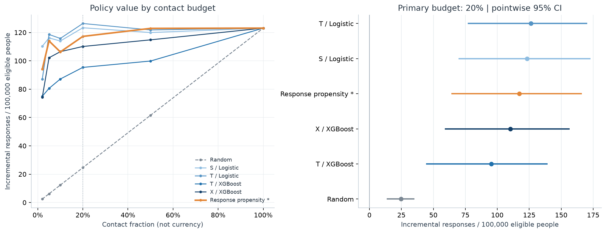

# Budget-Constrained Uplift Modeling on Criteo

**广告增量转化建模与 20% 预算策略评估**。基于公开实验基准，把业务约束、因果识别、S/T/X 建模、离线策略评价和线上验证方案串成一条可复核流程。

核心问题：如果只给 20% 的合资格人群分配广告资格，应选择最可能购买的人，还是预测增量最高的人？主结果是 `conversion`，模型仅使用处理前匿名特征 `f0`–`f11`。

当前主实验已用真实 Criteo 数据完整重跑。验证集选择 response propensity 基线，测试集评价见下表。

## 先看结果

| 20% 预算策略 | 每 10 万待选人的估计增量转化 | 相对 response 的差值及配对 95% CI |
|---|---:|---:|
| 解析随机 | 24.61 | — |
| **冻结选择：response propensity** | **117.23** | 0 |
| S-Logistic | 123.32 | +6.10 [−1.77, 14.61] |
| T-Logistic | 126.33 | +9.10 [-10.33, 24.84] |
| T-XGBoost | 95.35 | -21.87 [-41.39, -6.15] |
| X-XGBoost | 110.12 | −7.11 [−31.51, 18.64] |

冻结 response 相对随机的差值为 **+92.61**，配对 95% CI **[50.02,132.15]**。分母是全部待选人，而非已触达人；20% 对应每 10 万人选 2 万人。区间条件于训练好的模型、固定 e 和样本臂人数，不包含训练/选型/e 估计及未知重复用户依赖。



- **13,979,592 行全量审计**；100 万行等概率抽样建模，按 T×Y 分层为 60/20/20。
- S-Logistic、T-Logistic、T-XGBoost、X-XGBoost，另有随机和转化概率强基线。
- 主选型指标：validation 的 20% HT 增量转化。辅助检查 lift/uplift、AUUC/Qini、效应校准和多个预算。
- 80 万开发行排除旧测试集，3 seeds×3 嵌套训练规模，另 3 个匿名特征组隔离划分：**12 个实验、48 次拟合**。X 在所有配置的主指标点估计均低于 response。
- SQLite 主外键、1:1 join、条件聚合和窗口排名，在 20 万冻结测试行上核对 Python HT，最大浮点差约 9.52e−13。
- 同预算线上策略 A/B 设计、样本量规划与显式成本/转化价值场景。

项目执行路径见 [Pipeline 导航](docs/PROJECT_PIPELINE.md)，Notebook 与产物映射、当前结果解释见 [结果导航](docs/RESULTS_GUIDE.md)，数据来源与限制见 [NOTICE](NOTICE.md)。公开数据的隐私抽样限制对原业务总体的外推。[Criteo 官方说明](https://ailab.criteo.com/criteo-uplift-prediction-dataset/)

## 三种使用方式

### 1. 直接阅读，无需下载原始数据

- [Pipeline 导航](docs/PROJECT_PIPELINE.md)：主流程、模块边界、输入输出、入口与复现命令。
- [结果导航](docs/RESULTS_GUIDE.md)：Notebook 01–06 与计算函数、写入函数、产物文件的对应关系，以及当前结果的解释边界。
- [指标理论与完整手算](因果推断理论/7.Metrics.md)。
- [Notebook 01—06](notebooks/)：已有代码、表格和图；没有本地实验时自动读取公开聚合快照。
- [Notebook 01–06](notebooks/)：按项目业务流程阅读；每页开头提供代码调用和结果文件导航。扩展敏感性结果、SQL 核对与业务假设情景见 Notebook 06。
- [公开结果目录](reports/published/)：小体积 CSV/JSON/PNG、SQL 和来源哈希。
- HTML 报告可下载后在浏览器打开；GitHub 通常展示 HTML 源文件，而非直接执行报告页面。

### 2. 本机验证安装和流程，无需原始数据

建议 Python 3.11，在项目根目录运行：

```bash
python -m venv .venv
# macOS / Linux
source .venv/bin/activate
# Windows PowerShell 使用 .venv\Scripts\Activate.ps1
python -m pip install -e '.[notebooks]'
python -m unittest discover -s tests -v
python scripts/run_demo.py --output artifacts/demo
python scripts/execute_notebooks.py
```

`run_demo.py` 使用明确标注的**合成随机实验**验证四个真实 learner 接口和策略评价；它的数值不替代上述 Criteo 结果。输出目录需要不存在。Notebook 默认执行公开结果；`--local-results` 可优先读取作者本地实验。

已有 Conda 环境的用户可先激活兼容环境再执行安装命令。macOS 如果缺少 OpenMP，按 [Pipeline 导航](docs/PROJECT_PIPELINE.md) 中的环境与运行说明配置。项目 `.runtime/` 中的本机二进制不上传。

`pyproject.toml` 定义可安装代码包和依赖范围；`requirements-tested.txt` 记录本次本机验证的直接依赖版本，**不是完整的跨平台 lockfile**。CI 已配置测试/演示/Notebook 检查，远端执行状态需上传后查看，不能把配置存在当作已通过。

### 3. 重新训练真实 Criteo 实验

自行从官方来源获取 v2.1 文件并放到 `data/raw/criteo-uplift-v2.1.csv`。运行代码从不写入 `data/`：

```bash
python run_pipeline.py --output artifacts/conversion_repeat
python run_stability.py --output artifacts/stability_repeat
python scripts/run_metrics_extension.py --output artifacts/metrics_repeat
python scripts/run_sql_audit.py --output artifacts/sql_repeat
```

后面三个入口默认分析当前本地主实验。若分析新 run，查看 `--help` 的 `--base-run` / `--source` / `--cache`。重训、稳定性研究与打分交付需要本地实验产物。完整入口、输出目录与复现命令见 [Pipeline 导航](docs/PROJECT_PIPELINE.md)。

## 项目结构

```text
README.md                    项目入口、结果与运行方式
pyproject.toml               依赖和可安装代码包
.gitignore                   排除数据/缓存/模型/本机环境
criteo_uplift/
  preparation.py             数据列与路径、文件指纹、抽样和划分
  diagnostics.py             全量审计、SMD/KS、SRM、C2ST 与可学习性
  evaluation.py              ATE、Uplift 排序指标、策略评价与区间
  training.py                结果可学习性检查、候选模型拟合与验证集选型
  holdout_evaluation.py      冻结模型的测试集评价与预测产物
  pipeline_io.py             通用 IO、结果路径与实验产物读写
  models.py                  S/T/X learner 与模型工厂
  reporting.py               已保存结果的 HTML 报告和图表
run_pipeline.py              完整实验编排、诊断刷新与报告收尾
run_stability.py             排除旧 test 的开发敏感性研究
score_policy.py              加载本地冻结模型生成预算名单
scripts/                     演示、执行 Notebook、快照与发布检查
notebooks/                   数据→诊断→模型→策略→手算→稳健性
reports/published/           可公开的小体积聚合证据
reports/published/*/queries.sql SQL 审计查询
tests/                      单元与合成端到端测试（不是 ML test set）
docs/                        主流程导航、Notebook 与结果文件映射；维护验收记录在 maintenance/
因果推断理论/                 数学笔记与未来观察研究计划
.github/workflows/ci.yml      上传后自动检查
```

`data/`、`artifacts/`、`.runtime/` 为本地目录，全部 Git 忽略；不会出现在公开仓库或发布 ZIP 中。原输入数据永久只读。

## 数学口径

$$Z_i=T_iY_i/e-(1-T_i)Y_i/(1-e),\qquad V_{20\%}=\frac{100000}{n}\sum_{i\in top(\lfloor .2n\rfloor)}Z_i.$$

e 在主实验中固定为 train 的处理比例估计。response propensity 指 $P(Y=1\mid X,T=1)$，不同于处理 propensity $P(T=1\mid X)$。传统前缀 lift 为两臂转化率差；plug-in gain 为覆盖率乘 lift；传统 Qini 为 $(R_1-R_0N_1/N_0)/n$。各面积使用全前缀，图才降采样，不做 perfect-ranking normalization。

当前主实验与 `metrics_v2` 使用 Qini v2，保留仅有对照组的零值前缀，并报告 plug-in 面积与配对区间。开发期稳定性研究按其记录的 Qini v1 口径积分。详见 [指标笔记](因果推断理论/7.Metrics.md)。

## 现有结论的限制与扩展顺序

没有用户/广告主 ID、时间、成本和贡献毛利；匿名特征组隔离不等于真正用户隔离。正式 SRM 缺少原设计比例而跳过。当前模型不是 K-fold cross-fitted X learner。未运行 500 万/全量训练、未开展线上策略 A/B。

后续优先验证扩样是否改善稀疏对照事件下的估计，并预先冻结新划分；无需为项目展示强制跑完所有行的模型。观察研究 IHDP 作为第二阶段方法附录，见 [计划与五份笔记](因果推断理论/补充/观察研究/1.Uber-dataset.md)。目前没有 IHDP 已运行结果，不将它列为已完成模块。

## 发布、来源与许可证

开始阅读代码时，先看 [Pipeline 导航](docs/PROJECT_PIPELINE.md)，再用 [结果导航](docs/RESULTS_GUIDE.md) 从 Notebook 追踪到计算函数和产物文件。`python scripts/check_publication.py` 核对公开快照；`python scripts/build_release.py` 生成小体积 ZIP，明确排除原始数据和个人本机环境。

原创代码采用 MIT。Criteo 数据及本仓库的数据派生输出按其 CC BY-NC-SA 4.0 条款保留归属与限制，见 [NOTICE](NOTICE.md)；MIT 不改变原数据的非商业条款。参考 Criteo AdKDD 2018 与 Künzel 等 meta-learner 研究。
